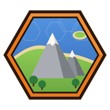
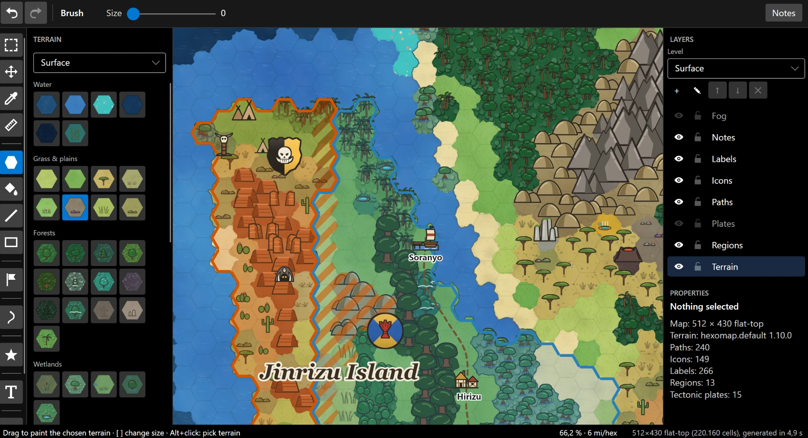
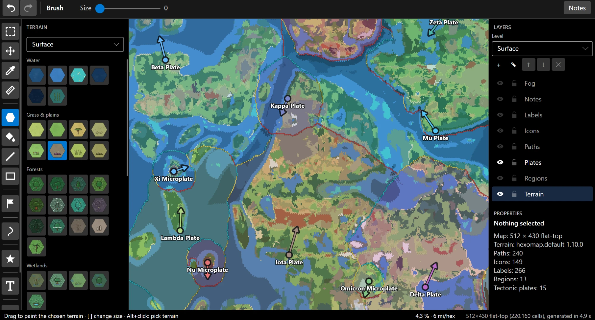
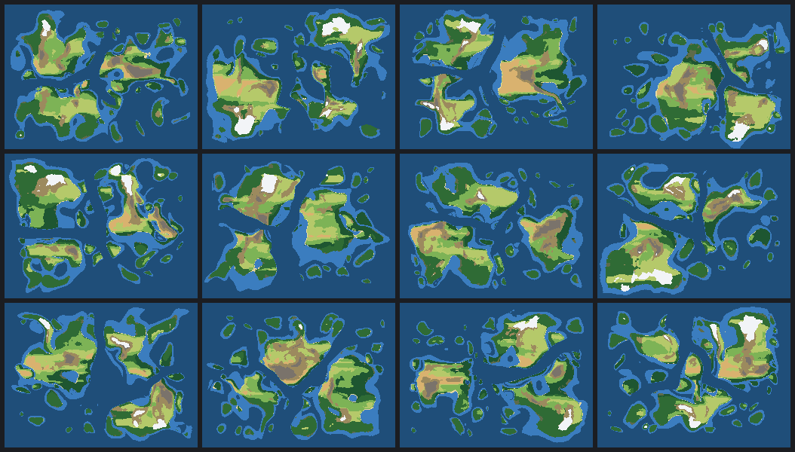
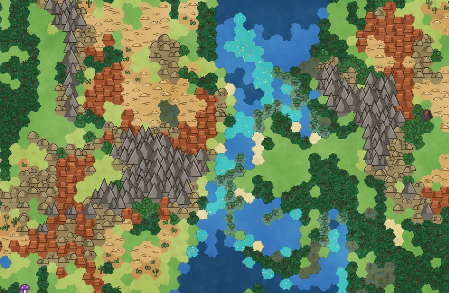
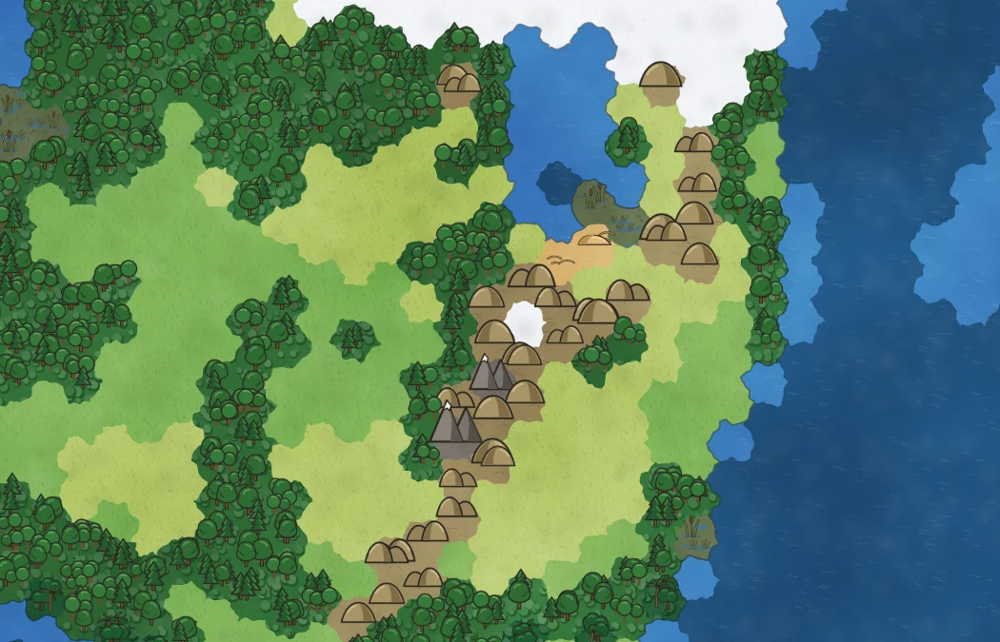

  

<h1 align="center">Hexomap</h1>

  <b>The hex-map editor for tabletop RPGs.</b> 
  Generate a world. Paint every hex. Bring it to the table.

  <a href="https://github.com/bartdebruin-tp/Hexomap-releases/releases/latest/download/Hexomap-win-Setup.exe"><b>Download for Windows</b></a>
  ·
  <a href="https://github.com/bartdebruin-tp/Hexomap-releases/releases/latest/download/Hexomap-linux-x64.tar.gz"><b>Download for Linux</b></a>

Join the <a href="https://discord.gg/KApEsGmDA">Discord</a> channel to talk about features and improvements.

Hexomap generates whole worlds for you: continents, coastlines, rivers, kingdoms, towns, roads and names. You can
then paint, label and annotate every hex in a hand-drawn style. It handles maps up to **4096 × 4096 hexes** and stays
smooth to pan and zoom, so a whole continent and a single village fit in the same file.

The free demo is the full app, not a time-limited trial. It never expires.

---

## Generate a world in seconds

Choose a preset, check the live preview and generate. A 512 × 430 world takes about five seconds.

- **Realistic land.** Coastlines vary from smooth beaches to fjords. Islands have lobes, bays and beaches, and some
  neighbouring continents are linked by islands across the sea between them.
- **Climate-driven terrain**, from tundra and glaciers to deserts, jungles and mangroves. Rivers run downhill to the
  sea, and lakes form along the way.
- **Kingdoms and provinces**, each kingdom with its own naming culture and a coat of arms. Towns are joined by roads,
  and land claimed by two kingdoms is shown as contested.
- **Tectonic plates** *(full version)*: mountains rise where plates collide, volcanic hot spots leave island chains,
  and you can inspect each plate's drift arrow.
- **Regenerate one area only**, and keep the parts of the map you already like.

  

## Hand-drawn, and still editable

<table>
  <tr>
    <td></td>
    <td></td>
  </tr>
</table>

Every hex has textured terrain with hand-drawn edges and an illustrated symbol for its terrain type. Themes restyle
the whole map at once.

- **Landscape, fantasy and themed terrain sets:** snowy hills, charred land, mushroom forest, cloud forest, coral reefs
  and more.
- **90+ map icons** in several icon themes, with names on icons.
- **Labels** for places, regions, seas, lakes, mountain ranges and islands.
- **Coats of arms** for every region, generated or designed in the built-in editor.
- **Flat-top or pointy-top hexes**, at any hex size you choose.

## Paint, annotate, explore

- **Painting tools:** brush, flood fill, line, rectangle, eyedropper, and cut, copy and paste of selections. Every change
  can be undone.
- **Paths:** rivers, roads, trails, sea routes and dotted lines.
- **Regions** with borders, **shapes** with labels along their outlines, and **notes** on any hex, object or map.
- **Detail maps:** open any hex as a map of its own and go from the world to a region to a city.
- **Battle maps:** any icon can hold a dungeon. It opens as a square grid measured in feet, with floors, walls, doors,
  stairs and props.
- **Map levels** (surface, underground and more), and **layers** you can show, hide and lock.
- **Trace a map from an image:** line up a sketch or a scanned map with the hexes and paint over it.

## At the gaming table

- **Fog of war** *(full version)*: hide the whole map and reveal it as the players explore.
- **View-only mode** for showing the map to players.
- **Map scale and a measuring tool**, for example 6 miles per hex.
- **PNG export**, which also works for very large maps.
- **Works offline.** After you activate your licence key, Hexomap keeps working for 30 days without a connection.

---

## Demo and full version

|                                                              | Demo (free)  | Full ($15, one-time) |
|--------------------------------------------------------------|:------------:|:--------------------:|
| World generator, every painting tool, icons, paths, labels   | ✓            | ✓                    |
| Illustrated style, all terrain and icon themes               | ✓            | ✓                    |
| Detail maps, notes, levels, PNG export, view-only mode       | ✓            | ✓                    |
| Map size                                                     | up to 512 × 430 | up to 4096 × 4096 |
| Increase the size of an existing map                         | –            | ✓                    |
| Fog of war                                                   | –            | ✓                    |
| Tectonic plates in the generator                             | –            | ✓                    |
| Detailed coats of arms (furs, patterns, several charges)     | simple ones  | ✓                    |
| Battle maps (dungeons on icons)                              | open only    | ✓                    |

Maps open in both versions. A licence key unlocks the app you already have installed: go to **Help → Licence…**, paste
the key and click **Activate**. You don't need to reinstall. No subscription;
**[Buy Hexomap: $15 →](https://hexomap.lemonsqueezy.com/checkout/buy/705970bd-818e-486c-89ad-3183fdf11030)** (in progress, right now unable to buy the product. But you can use the free version in the meantime which have almost all features unlocked until the licences haven been fixed)

## Download

Get the files from the **[latest release](https://github.com/bartdebruin-tp/Hexomap-releases/releases/latest)**. Each
download starts as the demo and becomes the full version when you enter a key.

| Download | Platform | Notes |
|---|---|---|
| [`Hexomap-win-Setup.exe`](https://github.com/bartdebruin-tp/Hexomap-releases/releases/latest/download/Hexomap-win-Setup.exe) | Windows 10 / 11, 64-bit | **Recommended.** Installs for your user, with no admin rights needed. Updates itself. |
| [`Hexomap-win-Portable.zip`](https://github.com/bartdebruin-tp/Hexomap-releases/releases/latest/download/Hexomap-win-Portable.zip) | Windows 10 / 11, 64-bit | Unzip and run from any folder or USB stick. Updates itself. |
| [`Hexomap-linux-x64.tar.gz`](https://github.com/bartdebruin-tp/Hexomap-releases/releases/latest/download/Hexomap-linux-x64.tar.gz) | Linux, 64-bit desktop | Unpack and run. `install.sh` adds a menu entry. Doesn't update itself: download the next archive and unpack it over the old one. |

You don't need to install .NET. There is no Mac version yet.

> **Windows SmartScreen** may say "unknown publisher" the first time you run the installer. Choose
> **More info → Run anyway**.

Each release lists what's new in its notes. Installed Windows copies check for updates when they start, or from
**Help → Check for updates…**.

---

This repository holds Hexomap's downloads and release notes only. Hexomap is commercial software; see
[LICENSE](LICENSE).
